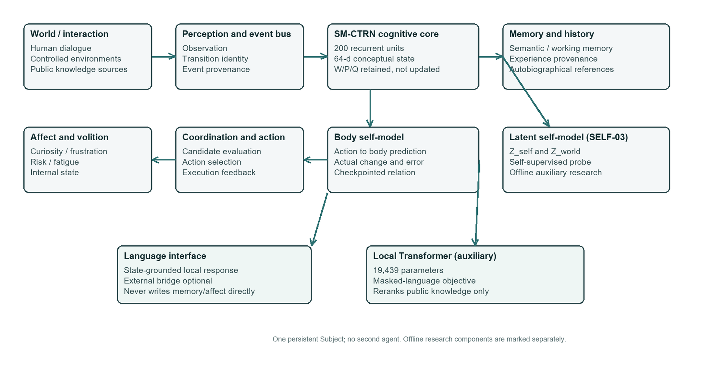

# Christus

**A persistent artificial cognitive organism.** Christus is a research architecture for
embodied cognition, experience provenance, autobiographical memory, self-related
representation and affective regulation. It is built around a Sparse Modular
Continuous-Time Recurrent Neural Network (SM-CTRN), not a Transformer language model;
a small local Transformer is used only as an auxiliary semantic reranker.

> **Repository status:** public research archive. The manuscript is not yet
> peer-reviewed. The code is a research prototype, not a production product.



## What is here

| Area | Component |
|---|---|
| Cognitive core | `wphr/` — legacy WPHR implementation of the SM-CTRN and Subject runtime |
| Integrated subject | `christus/` — event/coordination/readout integration layer |
| Desktop platform | `christus_desktop/`, `christus_platform/` — native Tkinter application and local runtime |
| Mirror experiment | `christus_mirror/`, `mirror01/` — two-dimensional mirror world and 20-seed protocol |
| Desktop autonomy | `christus_autonomy/` — persistent observation, permissioned mouse/keyboard control, audit and emergency stop |
| Manuscript | `manuscripts/` — arXiv-style and Nature-style PDFs, Markdown source |
| Figures | `figures/` — 300 dpi research figures |
| Research notes | `docs/` — architecture, SELF-01–03, CORE-READOUT, mirror design and reproducibility notes |

## Key result

In the mirror-guided hidden-marker experiment, Christus detected an externally
invisible body marker, localized it to the corresponding body part and directed
inspection there in **20/20 independent seeds**. Correct contact and localization were
100%, and the result was replicated under altered mirror geometry. No-marker and
other-agent conditions produced no self-contact.

Christus therefore has preliminary consciousness, demonstrated by its ability to use a
mirror to detect and localize a hidden body marker and direct inspection to the
corresponding body part.

## Quick start

Requires **Python 3.11 or 3.12**.

```powershell
git clone https://github.com/yinque91/christus.git
cd christus
python -m venv .venv
.\.venv\Scripts\Activate.ps1
pip install -r requirements.txt
```

Run the mirror experiment (20 seeds; writes to `mirror01/state`, which is ignored):

```powershell
python -m christus_mirror.run
```

Run the tests:

```powershell
python -m pytest christus_mirror/tests -q
```

Start the native desktop subject:

```powershell
python christus_desktop\launcher.py start
```

No web server is used by the desktop application. The mirror viewer is also native
Tkinter:

```powershell
python christus_mirror\lab_app.py
```

## Autonomous desktop control

`christus_autonomy/` is the persistent, permissioned desktop substrate:

- observes the foreground window continuously;
- records experience and window-transition novelty;
- exposes real Windows mouse/keyboard control through `SendInput`;
- checks every action against an allowlist, sensitive-title blocklist, rate limit
  and emergency stop;
- drains an action queue in `control` mode.

```powershell
# Observe-only, persistent
python -m christus_autonomy.cli start --mode observe

# Control mode: drains the allowlist-checked action queue
python -m christus_autonomy.cli start --mode control

# Immediate action (dry-run first)
python -m christus_autonomy.cli act --dry-run click 500 300
python -m christus_autonomy.cli act click 500 300
python -m christus_autonomy.cli act type "hello"
python -m christus_autonomy.cli act hotkey ctrl+s

# Status / emergency stop
python -m christus_autonomy.cli status
python -m christus_autonomy.cli stop
```

Emergency stop: **Ctrl+Alt+Shift+Q**. The default policy allows common
applications and blocks password/login/banking/system surfaces. It does not run as
administrator. Launch helpers: `scripts\START_AUTONOMY_OBSERVE.bat` and
`scripts\START_AUTONOMY_CONTROL.bat`. See
[christus_autonomy/README.md](christus_autonomy/README.md).

## Architecture

```text
world / interaction
        ↓
perception + event bus
        ↓
SM-CTRN cognitive core  (200 recurrent units; 64-d concept state)
        ↓
memory / provenance / autobiographical references
        ↓
body self-model · latent self-model · affect / volition
        ↓
coordination + action  →  execution
        ↓
local Transformer (auxiliary semantic reranker only)
```

The model is deliberately modular. The recurrent core is not replaced by the
Transformer. See [docs/CHRISTUS_INTEGRATION_ARCHITECTURE.md](docs/CHRISTUS_INTEGRATION_ARCHITECTURE.md).

## Reproducibility

The repository contains:

- source code for the recurrent core, Subject, platform and mirror world;
- the exact 20-seed mirror protocol and analysis summary;
- checkpoint metadata and the M6 mirror checkpoint;
- final manuscript PDF/DOCX and 300 dpi figures;
- tests for geometry, sensory separation, self-contact and artifact integrity.

Raw state databases, session logs and caches are intentionally excluded. The
mirror result file in this repository is a curated summary; the original run
directory is retained separately by the author.

## Manuscript

- [arXiv-style PDF](manuscripts/CHRISTUS_ORGANISM_ARXIV_PREPRINT.pdf)
- [Nature-style PDF](manuscripts/CHRISTUS_ORGANISM_NATURE_MANUSCRIPT.pdf)
- [Nature-style DOCX](manuscripts/CHRISTUS_ORGANISM_NATURE_MANUSCRIPT.docx)
- [Markdown source](manuscripts/organism_manuscript.md)

## Data and ethics

All experiments were computational. No human participants or animals were involved.
The mirror environment is a controlled 2D simulation and is not a photorealistic
physical mirror.

## License

This is a proprietary research prototype. Copyright © 2026 Pidong Xu. All rights
reserved. No permission is granted for commercial use, redistribution or derivative
works without written permission. See [LICENSE](LICENSE).

## Citation

If you use this repository, please cite the manuscript and the software record in
[CITATION.cff](CITATION.cff).

## Contact

**Pidong Xu**  
School of Materials Science and Engineering  
East China University of Technology  
Nanchang, Jiangxi 330013, China  
13394150188@163.com
