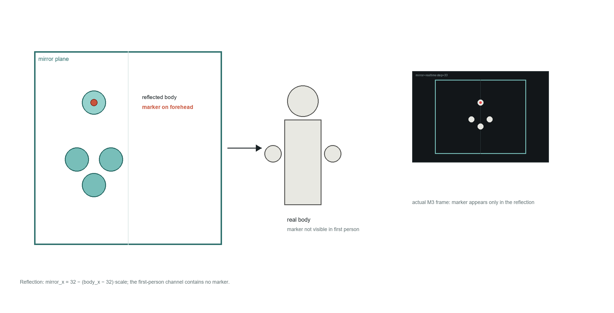
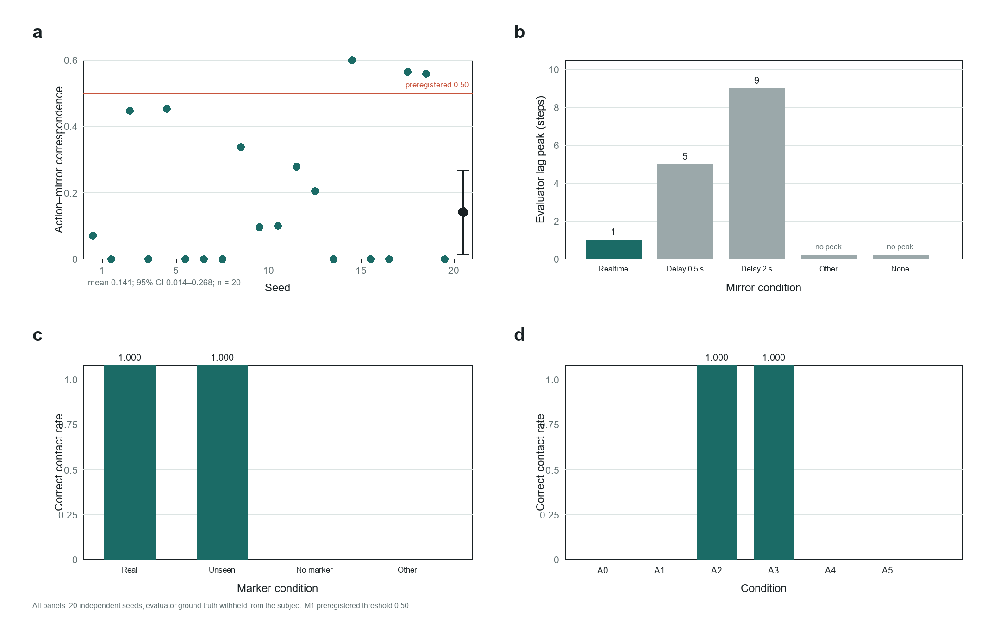

# MIRROR-01: mirror-guided body inspection

## Question

Can Christus use a mirror to discover a hidden marker on its own body, localize it
to the corresponding body part, and direct an inspection action there without being
told that the mirror shows its own body?

## Environment

A local two-dimensional feature-level mirror world with:

- a virtual body (head, left/right hand, torso);
- a true reflection transform about the mirror axis;
- first-person and mirror visual channels;
- body-state sensors;
- real-time, delayed, other-agent and no-mirror visual conditions;
- a hidden body marker visible only through the mirror.

The subject receives visual and body features, never a condition label, marker
coordinate or evaluator truth.

## Result

Twenty independent seeds were run. After 25 familiarization steps, a marker was
placed on a randomly chosen body part.

| Metric | Result |
|---|---:|
| Marker detected in the mirror | 100% |
| Inspection rate | 64.6% |
| Correct body-part contact | **100%** |
| Correct localization | **100%** |
| Replication under altered mirror geometry | **100%** |

No-marker and other-agent-marker conditions produced no self-contact.

The mirror test is used as a **causal probe** of self-related organization. It is one
component of the broader Christus programme, which also includes recurrent-state
action guidance, experience provenance, autobiographical continuity, prediction-error
learning and affective modulation.

## Protocol

- 20 seeds: 12000–12019;
- 30 free-exploration steps for M1;
- 25 steps per condition for M2, randomized condition order;
- 25 familiarization + 25 marker steps for M3–M5;
- M6: autobiographical memory record and checkpoint restoration.

Code: `christus_mirror/`. Curated summary: `mirror01/results.json`. Representative
frame: `mirror01/frames/M3_seed12000_marker.png`.
